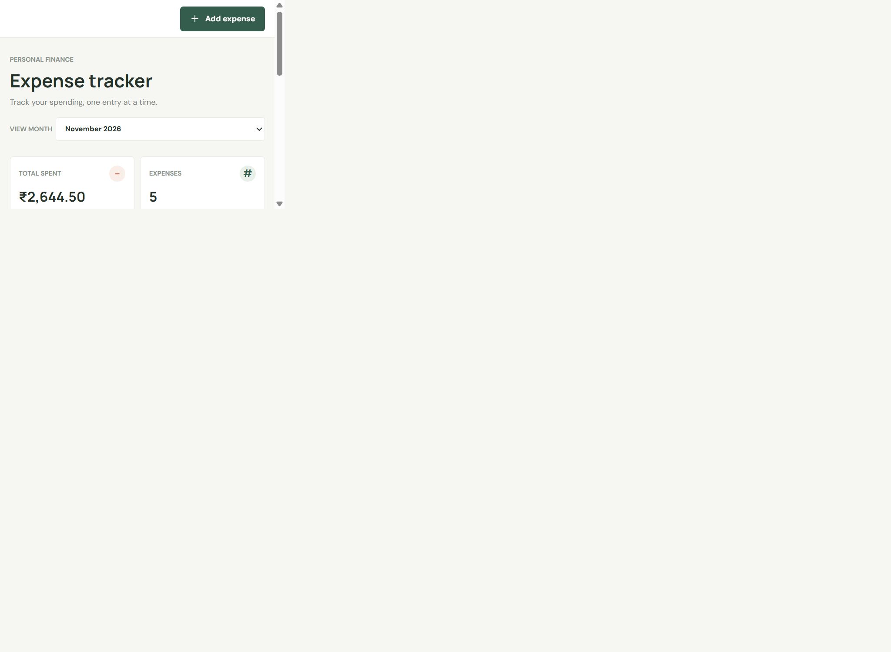

# Expense Tracker

A clean, private expense tracker built with HTML, CSS, and JavaScript. Track spending, review trends, and keep your finances organized.

**[Open the live Expense Tracker](https://shreyasharma2304bih-lgtm.github.io/Expense_Tracker/)**

## Features

- Monthly spending summary and transaction count
- Seven-day spending chart and category insights
- Add and delete expenses with category and date
- Search and filter transactions
- Export transactions as CSV
- Responsive layout
- Data stays in your browser on this device

## Run locally

Clone the repository and open `index.html` in a browser. No build tools or dependencies are required.

## Built with

- HTML5
- CSS3
- JavaScript

## Privacy

Transactions are stored in browser local storage on your device. They are not sent to a server.
